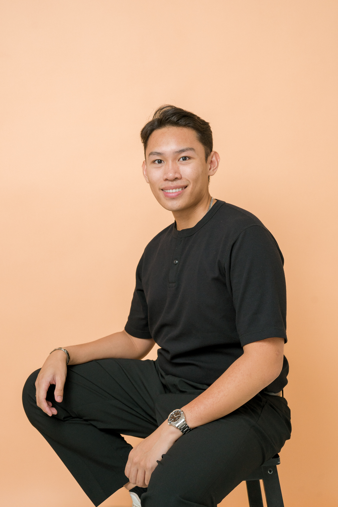

# 🪽 GE 4120 — DIGITAL PORTFOLIO

 

 

# Prince Arthone B. Dela Cruz

### 🎨 Art · 💨 Fart · 🛠️ Craft

<em>Student · Creative Explorer · Digital Experimenter</em>

`@fart2art` &nbsp;•&nbsp; 📍 Bukid, Philippines &nbsp;•&nbsp; 🎓 BSN 4F

 

---

## 👤 About Me

> *"Some ideas are strange. Some ideas are beautiful. Sometimes, the strange ones become beautiful."*

Hey! I'm **Prince Arthone B. Dela Cruz**, a student from **Ateneo de Davao University**, currently taking **BSN 4F**.

Welcome to my digital corner — a collection of ideas, experiments, designs, projects, and discoveries from my journey through **GE 4120: 21st Century IT Skills**.

I enjoy exploring creative ideas, visual design, branding, technology, and the ways digital tools can transform concepts into meaningful outputs.

I believe creativity doesn't always begin with something perfect. Sometimes, it begins with curiosity, a random idea, a little chaos, and the willingness to turn something unexpected into something meaningful.

That is the idea behind my personal creative identity:

 

### 🪽 Turning Fart to Art.

### 🧩 Things I enjoy exploring

- 🎨 Visual design and creative expression
- 💡 Turning ideas into projects
- 🖥️ Digital tools and technology
- 🤖 Artificial intelligence and experimentation
- 📚 Learning new skills and perspectives
- 🌱 Finding creative solutions to real-world problems

---

## 🧪 About This Portfolio

This repository showcases my **Final Requirement for GE 4120: 21st Century IT Skills**.

It brings together seven activities that explore different areas of digital creativity, information technology, communication, innovation, and artificial intelligence.

Each activity represents a different experiment — from designing promotional materials and building a visual identity to exploring environmental technology, digital collaboration, website planning, and AI-assisted content generation.

### ✨ What this portfolio represents

| | |
|---|---|
| 🎨 **Creativity** | Expressing ideas through design and visual communication |
| 💻 **Technology** | Exploring digital platforms and technological tools |
| 🤖 **Artificial Intelligence** | Experimenting with and evaluating AI-generated outputs |
| 🌱 **Innovation** | Connecting technology with real-world problems |
| 🧠 **Critical Thinking** | Evaluating, comparing, and improving digital outputs |
| 🛠️ **Practical Application** | Turning concepts into actual projects and deliverables |

---

## 🎨 My Brand Identity

My portfolio follows a visual identity inspired by warmth, texture, creativity, and simplicity.

### ☕ Color Palette

| Color | Hex Code | Purpose |
|---|---|---|
| Dark Roast | `#3B2418` | Dark backgrounds and strong visual elements |
| Signature Brown | `#4C2A1A` | Primary brand color |
| Mocha | `#6F4E37` | Section accents and supporting elements |
| Caramel | `#A47148` | Highlights and decorative details |
| Latte | `#D2A679` | Secondary accents |
| Vanilla Cream | `#FFE4A7` | Text, highlights, and contrast |

### ✍️ Typography

- **HK Modular** — headings, titles, and bold statements
- **Liham** — descriptions and expressive text
- **Canva Sans** — labels and readable information

### 🪽 Brand Symbol

The winged letter **"A"** represents the creative identity behind the portfolio, designed with a leather-inspired texture and a distinctive visual character.

The goal is to create something personal, recognizable, and a little unconventional.

---

# 🗂️ Activities 1–7

Seven activities. Seven different explorations. One creative journey.

---

## ☕ Activity 1 — Presentation Design Principles

VISUAL COMMUNICATION · LAYOUT · DESIGN

A promotional flyer for a **Free Coffee Giveaway at Arrupe Booth 7**, designed using coffee-cup shapes as the primary structure rather than a conventional rectangular layout.

### 🎨 Design elements

- **Shape as structure** — the stacked coffee cups form the foundation of the design.
- **Contrast** — cream, brown, and tan create visual separation.
- **Visual hierarchy** — the most important message receives the greatest emphasis.
- **Texture** — torn-paper elements create a handcrafted appearance.
- **Visual motifs** — coffee beans reinforce the concept.

This project explores how creativity and presentation design principles can transform a simple promotional message into a visually engaging composition.

---

## 🪽 Activity 2 — Color Palette & Typography

PERSONAL BRANDING · VISUAL IDENTITY

The creation of a personal visual identity centered around a winged **"A"** logo and the tagline **"Turning Fart to Art."**

### 🖌️ Design elements

- A dark brown and light orange color palette.
- A logo concept and visual symbol.
- Typography selection.
- Branding consistency.
- A personal business card.

This activity explores how colors, typography, logos, and visual elements combine to create a cohesive and recognizable identity.

---

## 🌊 Activity 3 — Tracking the Tide

INFOGRAPHIC · ENVIRONMENT · IOT · INNOVATION

An infographic about **Global Plastic Pollution** paired with a mini project proposal introducing **EcoSort**, an IoT-based smart waste sorting and plastic pollution monitoring system.

### 🌱 The infographic explores

- Global plastic pollution.
- Causes and environmental consequences.
- Plastic waste statistics.
- Marine and ecosystem impacts.
- Sustainable solutions.

### 💡 The EcoSort concept

| Component | Purpose |
|---|---|
| 🗑️ Smart Bin | Monitors waste through sensors |
| 📱 EcoSort App | Provides collection and monitoring information |
| 🚨 Alert System | Identifies bins requiring attention |
| 📊 Analytics | Supports waste management decisions |

The project connects environmental awareness with technology, proposing a smarter approach to waste management and community sustainability.

---

## ☁️ Activity 4 — Google Drive Presentation

CLOUD STORAGE · COLLABORATION · PRODUCTIVITY

A presentation exploring **Google Drive** as a cloud-based storage and collaboration platform.

### ☁️ What was explored?

- Cloud storage and accessibility.
- File organization and management.
- File sharing.
- Collaboration.
- Digital productivity.

This activity highlights the importance of cloud-based tools in organizing information, collaborating with others, and accessing files across devices.

---

## 🏓 Activity 5 — Sunbreak vs. Arthone Apex 16

AI · PRODUCT DESIGN · MARKETING · COMPARISON

A comparative evaluation of AI-generated product pages for pickleball paddle products.

### 🔍 The comparison focuses on

- Product descriptions.
- Branding and visual presentation.
- Specifications.
- Layout and organization.
- Clarity and completeness.
- Marketing effectiveness.

This activity explores how AI can generate marketing content and how its outputs can be evaluated for quality, accuracy, creativity, and usability.

---

## 🎾 Activity 6 — BADINK Pickleball Court Website

WEB PLANNING · BUSINESS · USER EXPERIENCE

A website planning activity centered on **BADINK Pickleball Court**, a proposed pickleball court business.

### 🌐 Website objectives

- Promote the business and its services.
- Present court information.
- Display pricing and reservation details.
- Improve customer communication.
- Enhance accessibility and user experience.

This activity demonstrates the importance of defining website objectives before development, ensuring the website serves the needs of both the business and its customers.

---

## 🤖 Activity 7 — Comparative Resume Generation Using Multiple LLMs

ARTIFICIAL INTELLIGENCE · RESUME · CRITICAL EVALUATION

A comparison of resumes generated using **ChatGPT and Claude**, based on the same information and qualifications.

### 🧠 Comparison criteria

- Content quality.
- Resume structure.
- Organization.
- Clarity and readability.
- Formatting.
- Overall professional presentation.

This activity explores how different Large Language Models interpret prompts and produce outputs, highlighting the importance of evaluating, refining, and improving AI-generated work rather than accepting it automatically.

---

## 🎬 Final Requirement Presentation

This section contains the recorded walkthrough of my final portfolio, showcasing the repository organization, activities, design choices, outputs, and overall learning experience throughout GE 4120.

📽️ **Presentation File:** `PRELIM EXAM_DELACRUZ.mp4`

---

## 📚 Sources

- Stop Ocean Plastic. (2026). *Plastic pollution facts: 20 statistics you need to know.*
- Ocean Blue Project. (2026). *Plastic pollution statistics 2026: Facts, data & global impact.*
- Omni Calculator. (2026). *44+ plastic pollution statistics.*

---

### 🪽 Art · 💨 Fart · 🛠️ Craft

<em>Made with creativity, curiosity, and a little bit of chaos.</em>

 

© 2026 Prince Arthone B. Dela Cruz · GE 4120 Final Requirement

